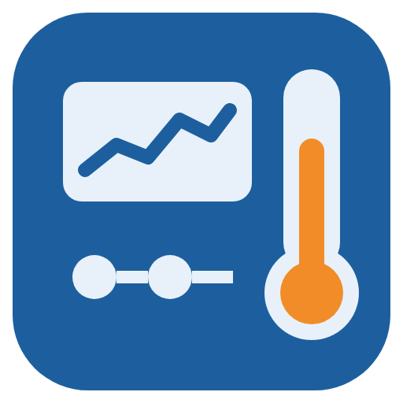
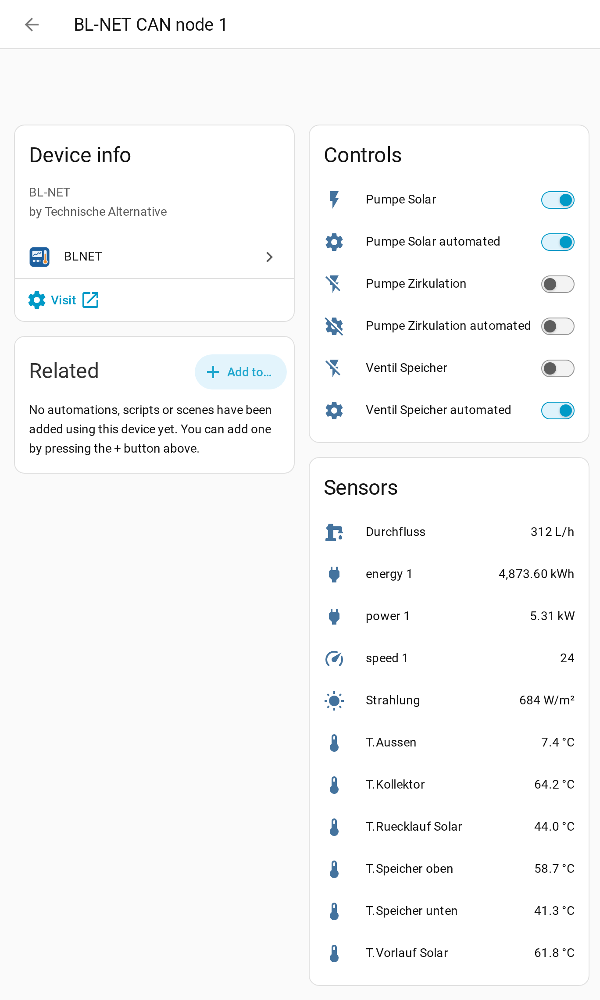
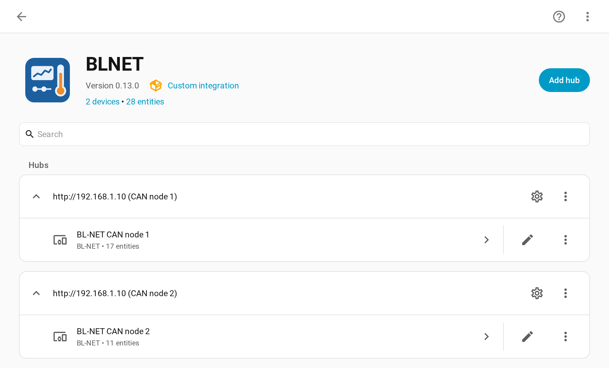

# BLNET custom component for Home Assistant

A custom component to integrate the freely pogrammable heating controller called [UVR1611 by Technische Alternative](https://www.ta.co.at/en/freely-programmable/uvr1611/)
via the BLNET web-interface into home assistant.

## Installation

Add this repository to [hacs](https://hacs.xyz/) or copy the `custom_components/blnet` file structure into your custom_component directory .

Afterwards, restart Home Assistant and add the integration under
**Settings → Devices & services → Add integration → BLNET**. Enter

- the address of your BL-NET, e.g. `http://192.168.1.10`,
- the password of the "Expert" user, if one is set,
- optionally the CAN node of the UVR1611 to read (left empty, the one set on the BL-NET is used),
- whether to use the web interface (needed to name values and to switch outputs) and the direct connection (reads speed, power and energy values), and their ports.

The poll interval (default 360 seconds) can be changed under the integration's **Configure** button.
The address, password, CAN node and connections can be changed later with **Reconfigure** in the entry's menu.

Each BL-NET (or each CAN node of it) becomes a device holding all its values,
the digital outputs as switches and the inputs as sensors:

## Several UVR1611 behind one BL-NET

Add the integration once per UVR1611, with the same address and the CAN node of that UVR1611.
Each CAN node becomes its own device. The BL-NET is only asked about one node at a time.

The CAN node selects what is read via the web interface.
The direct connection always reads the data the BL-NET logs, whatever the CAN node.

## Moving from configuration.yaml

Setting the integration up in `configuration.yaml` is deprecated.
A `blnet:` entry there is imported into the UI on the next start, with the same settings,
and the existing entities keep their entity ids and history.
Afterwards, Home Assistant asks you to remove the `blnet:` entry from `configuration.yaml`.

## A few notes

- Customization is fully supported.
- All entities of a BL-NET (or of one of its CAN nodes) belong to one device.
- Digital outputs of the UVR1611 can be controlled via created switch entities.
- __Turning a switch off or on overrides the `AUTO` configuration and sets the switch to `HAND` until it is turned back to `AUTO` manually.__

## Contributions

Feel free to open Pull Requests here or at
the backend python script [pyblnet](https://github.com/PyBLNET/pyblnet).
